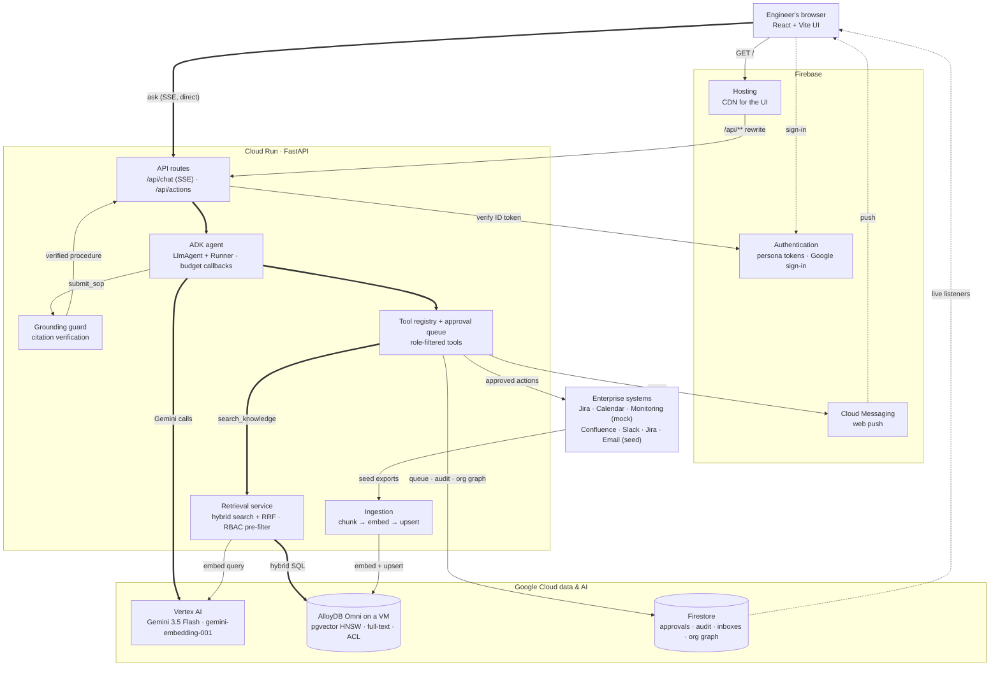
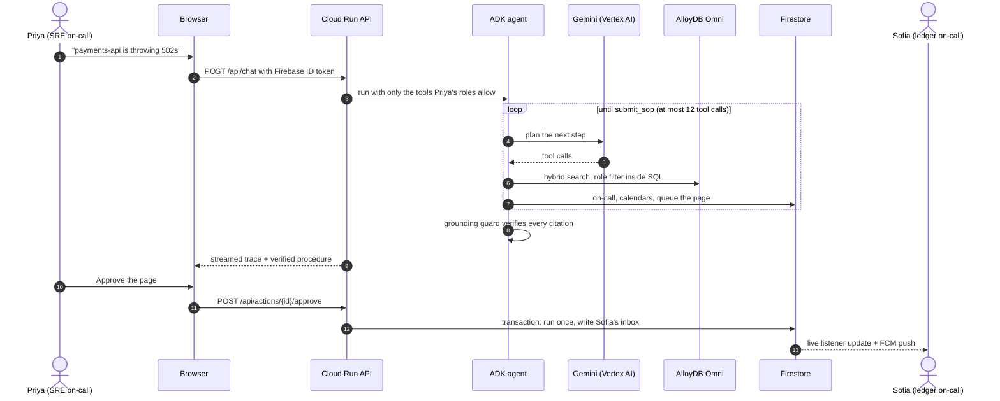

# Acme Second Brain: on-call co-pilot

An agentic knowledge fabric for engineering on-call. It turns runbooks, Slack threads, Jira tickets and emails, plus live telemetry and the org graph, into a **verified, step-by-step procedure with approvable actions**. Retrieval and actions are filtered by the user's role.

**Core loop:** question → RBAC-filtered hybrid retrieval → live telemetry and org-graph lookups → agent proposes actions → grounded SOP with citations → human approves → action executes → the person paged sees it live.

**Live:** UI on Firebase Hosting at https://aibuildercupprj.web.app (API on Cloud Run).

## Architecture



### Ask → approve → page, step by step



Two databases, each for what it does best: **AlloyDB Omni** (the AlloyDB engine, self-run on a Compute Engine VM) answers "which authorized chunks are most relevant" in one hybrid SQL query; **Firestore** holds small per-user, transactional state that the browser watches live.

| Concern | Where |
|---|---|
| Source connectors (Slack/Confluence/Drive/Jira/Gmail stubs) | `backend/app/connectors/` |
| Hybrid search + RBAC | `backend/app/retrieval/` (`alloydb_store.py` has the single-query hybrid SQL) |
| Agent: ADK runtime (`adk_runtime.py`, default) or native Gemini loop (`orchestrator.py`), prompts, grounding | `backend/app/agent/` (`AGENT_RUNTIME=adk\|native`) |
| Tools and adapters (incl. Firebase chat: Firestore inbox + FCM) | `backend/app/tools/` |
| Operational state: memory or Firestore | `backend/app/state/` |
| Auth: demo JWT or Firebase Auth | `backend/app/auth/` |
| Firestore security rules (browser reads only its own data) | `firestore.rules` |
| Seed corpus (fictional Acme Pay) | `backend/seed_data/` |

### Extending integrations
- **New knowledge source:** subclass `SourceConnector`, map the source's permissions to `acl_roles`, and add it to `seed_connectors`.
- **New action system:** implement the matching interface in `tools/adapters/interfaces.py` and select it with an env var (`JIRA_ADAPTER=real`, …).
- **Roles for Google sign-in users:** `python -m scripts.grant_roles someone@example.com engineering sre` (Firebase custom claims).

## Run locally (no Docker)

Prerequisites: Python 3.11+, Node 20+, and gcloud logged in to a project with Vertex AI enabled.

```powershell
gcloud auth application-default login      # recommended; otherwise the app falls back to gcloud CLI tokens

# backend
cd backend
python -m venv .venv; .venv\Scripts\pip install -r requirements.txt
.venv\Scripts\python -m uvicorn app.main:app --port 8000

# frontend (second terminal)
cd frontend
npm install; npm run dev                    # http://localhost:5173
```
Alternatively, run `npm run build` once; FastAPI then serves the UI at http://localhost:8000. Firebase features are off by default; see `backend/.env.example` to turn them on.

To run the agent from the CLI: `.venv\Scripts\python -m scripts.ask priya "payments-api is throwing 502s"`

To run the tests (offline: fake embedder, in-memory state): `.venv\Scripts\python -m pytest -q`

## Deploy
```powershell
./infra/setup_omni.ps1                                         # AlloyDB Omni VM (billable, ~5 min); reads OMNI_PASSWORD from backend/.env
gcloud compute start-iap-tunnel omni-vm 5432 --local-host-port=localhost:15432 --zone us-central1-b   # second terminal
cd backend
.venv\Scripts\python -m scripts.init_alloydb --omni            # schema + ingest through the tunnel
.venv\Scripts\python -m scripts.setup_firebase                 # Firestore rules + org graph seed (once)
cd ..; ./infra/deploy_cloudrun.ps1                             # Cloud Run: Omni (Direct VPC egress) + Firestore + Firebase Auth + FCM
cd frontend; npm run build; cd ../backend
.venv\Scripts\python -m scripts.deploy_hosting                 # UI to Firebase Hosting (/api/** → Cloud Run)
```
The Omni VM has no public IP: Cloud Run reaches it over Direct VPC egress, and the firewall admits port 5432 only from that subnet and from IAP. The database password lives in Secret Manager, mounted into Cloud Run as `OMNI_PASSWORD`. Cloud Run signs Firebase custom tokens as its own service account.

Omni runs the same SQL as managed AlloyDB, so switching back is a deploy flag: `./infra/setup_alloydb.ps1`, then `scripts.init_alloydb <iam_db_user>` and `./infra/deploy_cloudrun.ps1 -Store alloydb` (Python Connector with passwordless IAM database auth). Omni is free for prototyping and demos; production use needs an Omni subscription, and you run backups, upgrades and high availability yourself.

## Demo script (about 5 minutes)
1. **Open two windows** on https://aibuildercupprj.web.app: one as **Sofia** (ledger on-call), one as **Priya** (SRE on-call). Optionally click **Turn on alerts** in Sofia's window.
2. **Priya:** "payments-api is throwing 502s, started about 20 minutes ago. What do I do?"
   - Watch the trace. The agent finds the runbook, checks telemetry (ledger p99 2.9 s, `ledger_async_writes` on), and links it to **PAY-1287** and the Slack thread.
   - It checks the on-call rota (from Firestore) and calendars, then drafts a ticket and pages.
3. **Approve** the page to `#ledger-oncall`: the card says "Paged Sofia Martins, Marcus Okafor", and **Sofia's window shows it instantly** (Firestore listener, plus a push notification if alerts are on). Approve the Jira ticket: it returns `INC-5xx`.
4. **Switch to Alex (engineer)** and ask again. The restricted mTLS postmortem and SEC-77 no longer appear in sources.
5. **Switch to Jordan (contractor)** and ask again. Jordan has no runbooks and no telemetry tool, so severity is "unknown" with honest gaps, and the procedure is to escalate.
6. Optional: change `org/oncall` in the Firebase console; within 30 seconds the agent pages the new on-call engineer.
